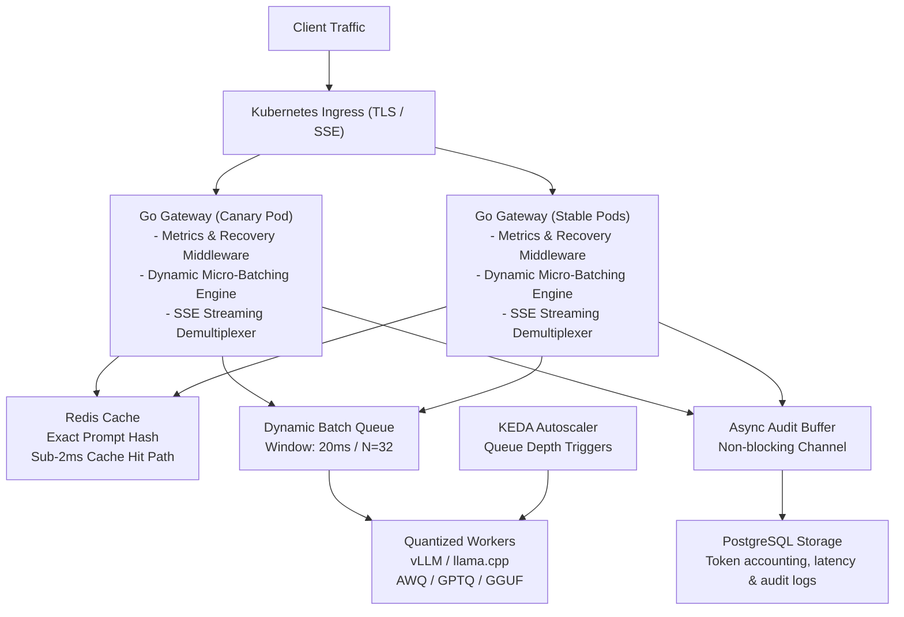

# High-Scale Quantized LLM Serving Platform

A production-grade, horizontally scalable inference serving system designed for quantized Large Language Models (AWQ, GPTQ, GGUF).

Built with **Go** for high-throughput gateway routing and dynamic micro-batching, **Kubernetes & KEDA** for multi-tier autoscaling, **ArgoCD & Argo Rollouts** for GitOps canary deployments with automated rollbacks, **Redis** for prompt caching, and **PostgreSQL** for asynchronous audit logging and token accounting.

---

## 🏛️ System Architecture



---

## 🚀 Core Components

### 1. Go API Gateway & Dynamic Batching Engine (`cmd/gateway`, `internal/batcher`)
* **Dynamic Request Batching**: Coalesces concurrent independent inference requests into unified tensor batches within a sliding window ($\Delta t = 20\text{ms}$ or $N = \text{max\_batch\_size}$).
* **Concurrency & Backpressure**: Protected by concurrency semaphores to prevent overwhelming GPU tensor cores.
* **Context Pruning**: Detects disconnected client HTTP streams and prunes dead requests before worker dispatch.
* **OpenAI-Compatible Endpoints**:
  * `POST /v1/chat/completions` (Supports both standard batched execution and Server-Sent Events `stream: true`).
  * `GET /v1/models` (Exposes quantized model metadata).
  * `GET /healthz` and `GET /readyz` (Kubernetes probes).
  * `GET /metrics` (Prometheus telemetry).

### 2. Distributed Rate Limiting Tier (`internal/ratelimit`)
* **Sliding Window Atomic Counter**: Executes an atomic Lua script in Redis over a 60-second sliding window, ensuring consistent rate limits across all autoscaled Gateway replicas without race conditions.
* **Identity Extraction**: Extracts client identity hierarchically:
  1. `Authorization: Bearer <token>` (hashed to `key:<sha256>`)
  2. `X-API-Key`
  3. `X-Forwarded-For` / `X-Real-IP` (origin IP)
  4. Remote socket address.
* **OpenAI-Compatible 429 Responses**: Returns structured JSON errors with standard HTTP headers: `X-RateLimit-Limit`, `X-RateLimit-Remaining`, `X-RateLimit-Reset`, and `Retry-After`.
* **Zero-Downtime Fallback**: Automatic in-memory sliding window fallback if Redis is unreachable.

### 3. Redis Caching Tier (`internal/cache`)
* Computes deterministic SHA-256 hashes combining model parameters, temperature, top-p, and normalized message history.
* **Cache Hits**: Bypasses the inference pipeline completely, returning responses in $<2\text{ms}$ with `X-Cache-Status: HIT`.
* **Cache Bypass**: Controlled via header `X-Cache-Bypass: true` or payload flag `"cache_bypass": true`.

### 3. PostgreSQL Telemetry & Token Accounting (`internal/storage`)
* Tracks request ID, model name, prompt tokens, completion tokens, TTFT (time-to-first-token), total latency, and client IP.
* **Decoupled Asynchronous Writer**: Uses an in-memory buffer (`BufferedAuditWriter`) and background worker to batch-insert records into PostgreSQL, eliminating database latency from the inference critical path.

### 4. Kubernetes Autoscaling (`deploy/kubernetes`)
* **Tier 1 (Gateway HPA)**: Scales Gateway pods based on CPU (70%) and RPS targets with rapid scale-up policies.
* **Tier 2 (Worker KEDA ScaledObject)**: Scales quantized worker pods based on real-time Prometheus queue metrics (`llm_queue_depth` and `llm_active_inferences`).
* **High Availability**: PodAntiAffinity spreads gateway pods across physical nodes; PodDisruptionBudgets (PDB) enforce zero downtime during node drains.

### 5. ArgoCD & Argo Rollouts (`deploy/argocd`)
* **GitOps Synchronisation**: ArgoCD `Application` monitors Git repository state and auto-reconciles drift.
* **Canary Progressive Rollout**: Traffic weight ramps through 10% $\to$ 25% $\to$ 50% $\to$ 100%.
* **Automated SLO Analysis & Rollback**: `AnalysisTemplate` queries Prometheus every 30s during rollouts. If the 5xx error rate exceeds $1\%$ or P99 latency exceeds $1.5\text{s}$, Argo Rollouts **aborts and rolls back to the stable replica set immediately**.

---

## 📦 Directory Structure

```
.
├── cmd/
│   ├── gateway/            # Go Gateway entrypoint
│   └── mock_llm/           # Quantized worker simulation (AWQ/GGUF emulation)
├── internal/
│   ├── backend/            # Backend client & batch wire protocol
│   ├── batcher/            # Dynamic micro-batching engine
│   ├── cache/              # Redis caching layer
│   ├── config/             # Environment configuration
│   ├── gateway/            # HTTP handlers, SSE streaming & middleware
│   ├── metrics/            # Prometheus metrics registry
│   ├── models/             # OpenAI-compatible domain models
│   └── storage/            # PostgreSQL connection pool & async buffer
├── deploy/
│   ├── argocd/             # ArgoCD Application, Rollout CRD & AnalysisTemplate
│   ├── docker/             # Production multi-stage Dockerfiles
│   ├── kubernetes/         # K8s Deployments, Services, HPA, KEDA & Ingress
│   ├── postgres/           # Database schema migrations & views
│   ├── prometheus/         # Prometheus scraper configuration
│   └── docker-compose.yml  # Local multi-container test stack
├── scripts/
│   ├── benchmark.sh        # Dynamic batching & cache load test
│   └── test_stream.py      # Real-time SSE token stream verification
├── Makefile                # Build, test, and run automation
└── README.md
```

---

## ⚡ Quickstart (Local Docker Compose)

The repository includes a self-contained local stack running the Go Gateway, a Quantized LLM Worker simulator, Redis, PostgreSQL, and Prometheus.

### 1. Build and Run
```bash
# Build Go binaries and run tests
make test build

# Start the complete local environment
make up
```

### 2. Verify Services
Check running containers:
```bash
docker compose -f deploy/docker-compose.yml ps
```

| Service | Port | Description |
|---|---|---|
| **Gateway** | `http://localhost:8080` | High-throughput Go LLM Gateway |
| **Worker** | `http://localhost:8000` | Quantized Model Inference Engine |
| **Redis** | `localhost:6379` | In-memory prompt cache |
| **PostgreSQL** | `localhost:5432` | Metadata & audit log store |
| **Prometheus** | `http://localhost:9090` | Telemetry & metrics dashboard |

---

## 🧪 Testing & Verification

### 1. Run Unit Tests
```bash
make test
```

### 2. Cold vs. Cached Request (Redis Acceleration)
```bash
# 1. Cold Request (Cache MISS -> Dispatched to Quantized Worker)
curl -i -X POST http://localhost:8080/v1/chat/completions \
  -H "Content-Type: application/json" \
  -d '{
    "model": "meta-llama/Llama-3-8B-Instruct-AWQ",
    "messages": [{"role": "user", "content": "What is 4-bit AWQ?"}]
  }'

# 2. Repeated Request (Cache HIT -> Sub-2ms instant response)
curl -i -X POST http://localhost:8080/v1/chat/completions \
  -H "Content-Type: application/json" \
  -d '{
    "model": "meta-llama/Llama-3-8B-Instruct-AWQ",
    "messages": [{"role": "user", "content": "What is 4-bit AWQ?"}]
  }'
```
Notice `X-Cache-Status: HIT` in the response headers.

### 3. Server-Sent Events (SSE) Streaming
Stream tokens with real-time TTFT telemetry:
```bash
python3 scripts/test_stream.py
```

### 4. High-Concurrency Dynamic Batching Benchmark
Simulate concurrent callers sending distinct prompts simultaneously:
```bash
make benchmark
```

---

## ☸️ Kubernetes & GitOps Deployment

### Deploy with kubectl

> [!NOTE]
> Ensure **KEDA** is installed on the cluster first, as [07-worker-keda-autoscaler.yaml](deploy/kubernetes/07-worker-keda-autoscaler.yaml) defines a custom `ScaledObject` resource (`keda.sh/v1alpha1`).

```bash
# 1. Install KEDA (CRDs + Operator)
kubectl apply --server-side -f https://github.com/kedacore/keda/releases/download/v2.16.1/keda-2.16.1.yaml
# (Or install only CRDs for dry-run validation: kubectl apply --server-side -f https://github.com/kedacore/keda/releases/download/v2.16.1/keda-2.16.1-crds.yaml)

# 2. Validate manifests
make k8s-dry-run

# 3. Apply all resources
kubectl apply -f deploy/kubernetes/
```

### Deploy via ArgoCD & Argo Rollouts
```bash
# 1. Register the GitOps Application
kubectl apply -f deploy/argocd/application.yaml

# 2. Deploy Canary Rollout with AnalysisTemplate
kubectl apply -f deploy/argocd/analysis-template.yaml
kubectl apply -f deploy/argocd/rollout.yaml

# 3. Monitor rollout progression
kubectl argo rollouts get rollout llm-gateway-rollout -n llm-serving --watch
```

---

## 📊 Prometheus Metrics Reference

| Metric Name | Type | Description |
|---|---|---|
| `llm_http_requests_total` | Counter | Total HTTP requests by method, path, and status |
| `llm_http_request_duration_seconds` | Histogram | Latency distribution of inference requests |
| `llm_batch_size` | Histogram | Size of batched inferences dispatched to workers |
| `llm_batch_processing_duration_seconds`| Histogram | Execution latency on quantized tensor cores |
| `llm_queue_depth` | Gauge | Requests waiting in micro-batch accumulator (KEDA metric) |
| `llm_active_inferences` | Gauge | Batches currently executing on workers |
| `llm_rate_limit_exceeded_total` | Counter | Total requests rejected due to rate limit violation |
| `llm_cache_hits_total` | Counter | Total Redis prompt cache hits |
| `llm_cache_misses_total` | Counter | Total Redis cache misses |
| `llm_time_to_first_token_seconds` | Histogram | Time to First Token (TTFT) distribution |
| `llm_prompt_tokens_total` | Counter | Total prompt tokens consumed |
| `llm_completion_tokens_total` | Counter | Total completion tokens generated |

---

## 📄 License
Apache 2.0. Built for production-scale quantized model serving.
